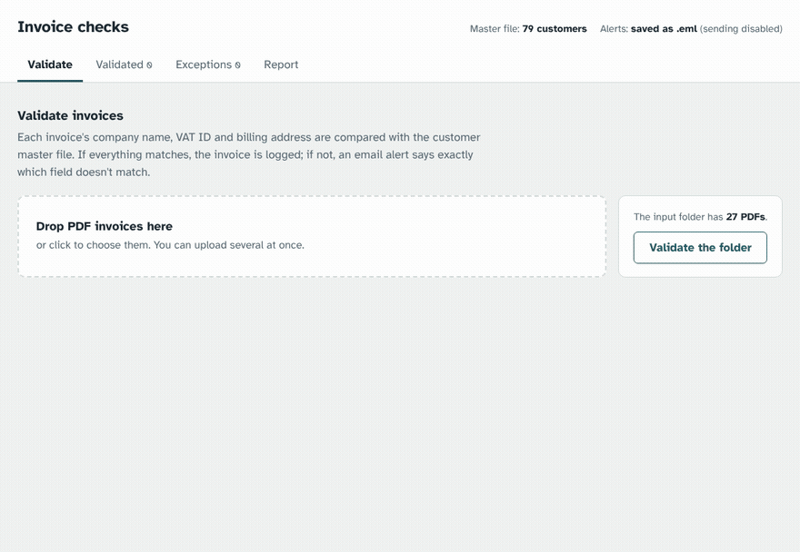

# Automated invoice checks against customer master data

An automated data-quality control. It reads each PDF sales invoice, compares the
customer's tax details with the customer master file, and decides:

- **Everything matches:** the invoice is logged with its validation timestamp.
- **Something doesn't match:** the invoice is not logged. An email alert names
  the exact field and both values, and the exception is recorded in an audit log.
- **The file can't be read:** it is never passed as valid. It goes to manual review.



## The business problem

Checking by hand, field by field, that the company name, VAT ID and billing
address on every invoice match the master data is slow and error-prone. And the
errors that matter are small: one wrong digit in a VAT ID, two swapped digits in a
street number, an outdated postcode. An invoice with wrong tax details causes
problems with the customer, with the tax authority and at month-end close.

## What it catches

The repo ships with a batch of **27 synthetic invoices** and a master file of
**79 customers**, with errors planted on purpose. The file
[`data/expected.csv`](data/expected.csv) is the ground truth: it records the
error in each invoice. The automated tests check that the control finds exactly
that error, no more and no less.

| Scenario | Invoices | Outcome |
|---|---|---|
| No errors | 10 | Logged |
| Formatting only (`S.L.`/`SL`, `C/`/`Calle`, upper case, `ES` VAT prefix) | 4 | Logged (not an error) |
| One wrong digit in the VAT ID | 2 | Alert: VAT ID |
| Street number with swapped digits (48 / 84) | 2 | Alert: street |
| One wrong digit in the postcode | 2 | Alert: postcode |
| One wrong letter in the company name | 1 | Alert: company name |
| Different town | 1 | Alert: town |
| Outdated postcode and town | 1 | Alert with both fields |
| Customer not in the master file | 1 | Alert: customer not found |
| Customer with no VAT ID in the master file | 1 | Alert: master data incomplete |
| Same invoice submitted twice | 1 | Skipped (already logged) |
| Scanned PDF with no text | 1 | Manual review |

Result: **14 logged, 11 alerts, 1 duplicate and 1 sent to manual review**. All
27 match the ground truth.

## Design decisions

**Format vs. content.** Before comparing, text is normalised (case, accents,
spacing, punctuation and equivalent abbreviations). After that, every field must
match character by character. So `C/ Mayor 12` and `Calle Mayor, 12` are equal,
but `Calle Mayor, 12` and `Calle Mayor, 21` are not.

**No fuzzy matching and no AI in the decision.** The errors to catch are
single-character ones, exactly what fuzzy matching or a language model tends to
let through. The master file also contains different companies with almost
identical names. An exact rule is more reliable, explainable and auditable, and
always gives the same result.

**Look the customer up by VAT ID, then by name.** If the VAT ID on the invoice is
wrong, the alert says "VAT ID differs" (useful to fix it) instead of "customer not
found".

**Audit trail.** Every exception is written to an Excel log with timestamp,
invoice, field and both values. The same exception is never alerted twice; if
anything changes, it counts as a new one.

**No false positives on "valid".** An unreadable, damaged or unexpected PDF is
logged for manual review, never as a validated invoice.

## How this applies to risk, compliance and data quality

The same pattern works beyond invoicing: checking customer data against a
reference source (KYC), flagging identifiers that don't match, keeping a trace of
every exception, and never accepting a record that can't be verified. It is an
automated control with reproducible, auditable results.

## How to run it

Requires Python 3.10 or later.

```bash
pip install -r requirements.txt
python web.py                         # web app at http://127.0.0.1:8000
python invoice_checks.py validate     # or from the command line
python -m unittest discover tests -v  # 27 automated tests
```

On Windows you can also double-click `start_web.bat`.

Report by date (validation date or invoice date):

```bash
python invoice_checks.py report --from 2026-10-01 --to 2026-10-31 --by invoice
```

**Email.** Sending is off by default and each alert is saved as an `.eml` file in
`output/alerts/`. To send through SMTP, fill in `config.json` and put the password
in the `SMTP_PASSWORD` environment variable, never in a file.

**Demo data.** Regenerate it with `python synthetic_data/generate_data.py`
(same seed, same data).

## Project structure

| File | What it does |
|---|---|
| `app/extraction.py` | Reads the PDF and extracts customer details and amounts |
| `app/validation.py` | Normalises and compares against the master file; decides if it matches |
| `app/ledger.py` | Writes the validated-invoice log and the exceptions log |
| `app/alerts.py` | Builds and sends (or saves) the alert email |
| `app/report.py` | Filters by date and builds the Excel report |
| `app/service.py` | Orchestrates the process; shared by the web app and the CLI |
| `web.py`, `web/index.html` | Web interface (FastAPI) |
| `invoice_checks.py` | Command line |
| `synthetic_data/generate_data.py` | Generates the master file, the invoices and `expected.csv` |

## Limitations and next steps

- It reads a known invoice template (text-based PDF). For very different
  formats, a model could extract the fields; the comparison would stay the same
  exact rule.
- The logs are Excel files, which is enough for a prototype. With several users or
  more volume they would move to a database.
- Natural next control: check EU VAT IDs against VIES and the check digit of
  Spanish tax IDs.

## Data

All data is synthetic and generated by the script in this repo: companies,
addresses, tax IDs and amounts are made up. Any resemblance to a real company is
coincidental.

Stack: Python, pdfplumber, openpyxl, FastAPI. License: MIT.
